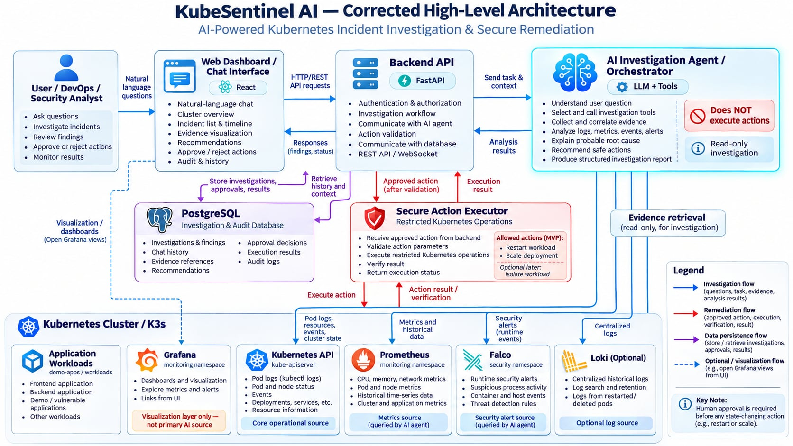

<div align="center">

# 🛡️ KubeSentinel

### AI-Powered Kubernetes Observability, Incident Investigation & Security Analysis

**From scattered cluster signals to explainable, evidence-backed incident investigations.**

[](https://k3s.io/)
[](https://fastapi.tiangolo.com/)
[](https://www.python.org/)
[](https://prometheus.io/)

**[Overview](#overview) · [Architecture](#system-architecture) · [Features](#features) · [Real Incident](#real-world-incident-image-not-found) · [Getting Started](#getting-started) · [Engineering Plan](#engineering-plan)**

</div>

---

## Overview

**KubeSentinel** is a DevOps/SRE-focused platform under active development that aims to make Kubernetes troubleshooting faster, more systematic, and easier to explain. Instead of manually switching among `kubectl`, dashboards, logs, metrics, and security alerts, engineers will be able to investigate an incident through a unified workflow.

The platform is designed to collect **Kubernetes resource states and events**, **container logs**, **Prometheus metrics**, and **Falco runtime security alerts**, then correlate them into a structured investigation. A future **LLM-powered investigation agent** will use this evidence to generate transparent hypotheses, probable root causes, and recommended next steps—with human review before potentially disruptive remediation.

> **Current scope:** A real K3s environment, an e-commerce microservices test workload, Prometheus/Grafana monitoring, a read-only FastAPI Kubernetes integration, and a rule-based incident-reporting capability demonstrated through structured incident output. Cross-source correlation, Loki/Falco ingestion, LLM reasoning, and automated remediation are **planned**, not presented as completed features.

## The Problem

Kubernetes can restart failed containers and reconcile desired state, but it does not automatically explain every underlying cause. A Pod stuck in `Pending`, for example, might be blocked by a missing container image, missing configuration, scheduling constraints, or resource pressure.

Investigating failures often requires manually connecting information from different places:

- **Kubernetes API:** Pod conditions, container states, restart counts, and events.
- **Metrics:** Resource consumption, workload health, and performance trends.
- **Logs:** Application errors and execution context.
- **Security telemetry:** Suspicious runtime behavior and policy violations.

**KubeSentinel's goal is to connect these signals and distinguish observed facts from inferred explanations.**

## System Architecture



*KubeSentinel's target architecture, illustrating the investigation workflow, evidence sources, and a separate human-approved action pathway.*

The system separates **read-only incident investigation** from **state-changing operations**. Engineers use the React dashboard and FastAPI backend to inspect Kubernetes workloads and request investigations. The AI investigation agent is designed to retrieve and correlate evidence from the **Kubernetes API** (Pod status, events, and recent logs), **Prometheus** (metrics), **Loki** (centralized historical logs), and **Falco** (runtime security alerts). It produces an evidence-backed explanation of probable causes and recommended next steps; **it does not restart Pods or independently execute remediation**.

Any future operational action must follow a distinct control path: **human approval → backend validation and authorization → restricted action executor → Kubernetes API → execution verification and audit trail**. This executor is a proposed architectural component, not a capability granted to the investigation agent. The image also shows PostgreSQL as the proposed investigation/audit store; this is distinct from the PostgreSQL database already used by the e-commerce demo workload. Grafana provides visualization rather than being the primary source of investigation evidence.

### Deployment environment

The development/test infrastructure currently uses **Ubuntu 24.04 in VMware**, running a **single-node K3s cluster**. Development is performed from Windows using **VS Code Remote SSH**. The Kubernetes cluster contains an `ecommerce` namespace for the application and a `monitoring` namespace for the observability stack.

**E-commerce test workload**

| Component | Role |
| --- | --- |
| Frontend | Web interface for the demonstration application |
| API Gateway | Entry point for application API requests |
| User Service | User-related operations |
| Product Service | Product-related operations |
| Order Service | Order-related operations |
| PostgreSQL | Persistent relational data store |

This workload provides realistic failure scenarios for exercising the investigation backend rather than relying only on synthetic examples.

## Features

| Feature | Description |
| --- | --- |
| **Kubernetes Cluster Management** | Kubernetes-based environment powered by K3s, hosting an e-commerce microservices application with containerized services and persistent storage. |
| **Infrastructure & Application Monitoring** | Prometheus, Grafana, kube-state-metrics, and node-exporter for observing cluster health, resource utilization, and workload performance. |
| **FastAPI Investigation Backend** | Modular Python REST API serving as the integration layer between Kubernetes, observability tools, and incident investigation workflows. |
| **Namespace & Pod Discovery** | Retrieve Kubernetes namespaces, Pod lifecycle phases, container readiness, restart counts, and waiting or termination reasons. |
| **Pod Diagnostics & Evidence Collection** | Gather Pod conditions, container states, Kubernetes events, and recent container logs with bounded retrieval and explicit handling of missing evidence. |
| **Secure Kubernetes API Access** | Dedicated `investigation-reader` ServiceAccount, least-privilege RBAC, and restricted credentials for read-only access to diagnostic resources. |
| **Rule-Based Incident Detection** | Recognize Kubernetes failure patterns such as `ErrImageNeverPull`, `ImagePullBackOff`, `CrashLoopBackOff`, `OOMKilled`, and scheduling or configuration errors; organize findings into structured incident reports. |
| **Evidence-Based Root Cause Analysis** | Separate observed symptoms and supporting evidence from probable explanations, confidence limitations, and recommended investigation steps. |
| **Metrics Correlation** | Enrich incident investigations with Prometheus time-series data covering CPU, memory, restarts, and workload behavior around failure windows. |
| **Centralized Log Investigation** | Aggregate application and container logs using Grafana Alloy and Loki to support historical searches and cross-service troubleshooting. |
| **Runtime Security Analysis** | Incorporate Falco security alerts to investigate suspicious container and Kubernetes runtime activity alongside operational incidents. |
| **LLM-Assisted Investigation** | Use an AI investigation agent to correlate metrics, events, logs, and security signals and generate evidence-grounded hypotheses and actionable recommendations. |
| **Web-Based Investigation Dashboard** | React interface for exploring cluster status, incident timelines, diagnostic evidence, and investigation reports from one place. |
| **Human-Approved Remediation** | Support reviewable corrective actions governed by explicit approvals and narrowly scoped Kubernetes permissions. |

## Backend API

The Kubernetes evidence-collection API has been exercised against the live K3s cluster:

| Method | Endpoint | Description |
| --- | --- | --- |
| `GET` | `/api/health` | Backend liveness check |
| `GET` | `/api/namespaces` | List accessible Kubernetes namespaces |
| `GET` | `/api/pods?namespace=ecommerce` | Inspect Pods and container states |
| `GET` | `/api/pods/{namespace}/{pod_name}/diagnostics?tail_lines=100` | Collect detailed diagnostic evidence |

An incident-reporting layer has also produced structured results with fields such as `incident_id`, `incident_type`, `severity`, `supporting_evidence`, `likely_explanation`, `recommended_investigation_steps`, and `evidence_limitations`. Consult the current backend source before relying on a particular incidents endpoint path, since its deployed route has not been independently verified in this README.

### Why structured investigations?

A report is more useful when it separates **evidence** from **interpretation**:

```json
{
  "incident_type": "ErrImageNeverPull",
  "severity": "medium",
  "supporting_evidence": [
    "Container image \"ecommerce-gateway:v1\" is not present with pull policy of Never",
    "Configured image: ecommerce-gateway:v1",
    "Image pull policy: Never"
  ],
  "likely_explanation": {
    "kind": "inference",
    "statement": "The image is absent from the node while the pull policy prevents Kubernetes from downloading it."
  },
  "recommended_investigation_steps": [
    "Verify the image exists in the node's container runtime or use an appropriate registry and pull policy."
  ],
  "evidence_limitations": [
    "A historical event does not, by itself, prove that the condition is still active."
  ]
}
```

*The JSON above is a shortened, presentation-friendly excerpt of an observed incident shape, not a guarantee of the current full API response contract.*

## Real-World Incident: Image Not Found

During live integration testing, the backend investigated an unhealthy API Gateway Pod in the `ecommerce` namespace.

**Observed evidence**

```text
Pod:          api-gateway-59747cd798-85kvc
Container:    api-gateway
Image:        ecommerce-gateway:v1
Failure:      ErrImageNeverPull
Pull policy:  Never
Event count:  895 (in the captured incident report)
```

### What happened?

The Deployment expected the `ecommerce-gateway:v1` image, but it was not available in the K3s node's **containerd image store**. With `imagePullPolicy: Never`, Kubernetes was instructed **not to download** the image from a registry. The container therefore could not be started from that missing local image.

**Key engineering insight:** A container image visible in Docker is not necessarily available to K3s/containerd. Image builds, exact tags, import workflows, and runtime stores must be consistent.

**Recommended verification:**

```bash
sudo docker images | grep ecommerce-gateway
sudo k3s crictl images | grep ecommerce-gateway
sudo k3s kubectl get pods -n ecommerce
```

The incident detector correctly included an **evidence limitation**: a recent event alone is not proof that the same failure is still active. This is essential for trustworthy incident analysis.

## Security by Design

KubeSentinel treats Kubernetes access as a security boundary rather than simply using cluster-admin credentials.

- **Dedicated ServiceAccount:** `investigation-reader`.
- **Least-privilege RBAC:** Read access for relevant Pods, Pod logs and events within the `ecommerce` namespace, plus required namespace metadata.
- **No write access for the investigation reader:** No Pod deletion, Deployment patching, or Kubernetes Secret retrieval permissions.
- **Restricted kubeconfig:** Local development kubeconfig created with owner-only permissions (`0600`).
- **Short-lived credentials:** Development bootstrap generates a time-limited ServiceAccount token; credentials must be renewed as necessary.
- **Evidence-aware reporting:** Unavailable logs or incomplete container states are reported as limitations, not silently fabricated.

Future remediation actions will be separated from read-only investigation, require explicit human approval, and use independent, narrowly scoped permissions.

## Getting Started

> **Prerequisites:** An operational K3s cluster, Python 3 with virtual environment support, access to the application repository, and permission to deploy the included reader RBAC. These instructions reflect the current **Ubuntu/K3s development setup**, not a one-command production deployment.

### 1. Open the backend

From the root of the checkout containing the backend:

```bash
cd investigation-backend
python3 -m venv .venv
source .venv/bin/activate
python -m pip install -r requirements.txt
```

### 2. Configure read-only Kubernetes access

Review the RBAC manifest and bootstrap script before applying cluster changes:

```bash
cat k8s/readonly-rbac.yaml
cat scripts/setup_local_readonly_kubeconfig.sh
```

In the authorized development environment, generate the dedicated kubeconfig:

```bash
bash scripts/setup_local_readonly_kubeconfig.sh
export KUBECONFIG="$HOME/.kube/investigation-reader.kubeconfig"
```

The development token is short-lived. Repeat the bootstrap procedure when the token expires, then restart the backend if necessary. **Never commit the generated kubeconfig or its token.**

### 3. Start the API

```bash
python -m uvicorn app.main:app --host 127.0.0.1 --port 8000
```

Access the interactive API documentation at:

```text
http://127.0.0.1:8000/docs
```

When developing from Windows through VS Code Remote SSH, forward **port 8000** from the Ubuntu VM to your local machine; otherwise the address above refers to Ubuntu itself.

### 4. Validate the integration

```bash
curl http://127.0.0.1:8000/api/health
curl http://127.0.0.1:8000/api/namespaces
curl "http://127.0.0.1:8000/api/pods?namespace=ecommerce"
```

To inspect a specific Pod:

```bash
curl "http://127.0.0.1:8000/api/pods/ecommerce/<pod-name>/diagnostics?tail_lines=100"
```

### 5. Run the tests

```bash
python -m pytest -v
```

The repository contains test files, but the latest complete automated test run has **not** been confirmed as part of this document. Live endpoint smoke checks were successful during Phase 1.

## Technology Stack

| Layer | Technologies |
| --- | --- |
| Infrastructure | Ubuntu 24.04, VMware, K3s, Docker, containerd |
| Orchestration | Kubernetes Deployments, Services, StatefulSet, PVC, RBAC, Traefik Ingress |
| Demo application | Python/Flask microservices, PostgreSQL |
| Backend | Python, FastAPI, Uvicorn, Pydantic, Kubernetes Python client |
| Monitoring | Prometheus, Grafana, kube-state-metrics, node-exporter |
| Logging (planned) | Loki, Grafana Alloy |
| Security telemetry (planned) | Falco |
| AI analysis (planned) | LLM-based agent with constrained tool access |
| Interface (planned integration) | React |
| Development | VS Code, Remote SSH, Git/GitHub |

## Engineering Plan

KubeSentinel follows a layered, evidence-first architecture. The engineering plan is organized around the capabilities needed to move from cluster telemetry to explainable investigations and controlled operational responses.

| Workstream | Engineering focus |
| --- | --- |
| **Kubernetes Foundation** | Run a containerized microservices environment on K3s with service networking, persistent storage, workload manifests, and reproducible failure scenarios. |
| **Observability Foundation** | Use Prometheus and Grafana to examine cluster and workload health, including CPU, memory, availability, and container restart behavior. |
| **Investigation API** | Expose Kubernetes resource discovery, Pod diagnostics, events, logs, and container lifecycle information through a modular FastAPI service. |
| **Incident Intelligence** | Detect Kubernetes failure patterns, group related evidence into structured incidents, and distinguish observations from inferred explanations. |
| **Telemetry Correlation** | Combine Prometheus metrics, Loki application logs, and Falco runtime security signals into a coherent investigation timeline. |
| **AI Investigation** | Equip an LLM agent with constrained investigation tools to analyze evidence, cite observations, discuss uncertainty, and recommend next steps. |
| **User Experience** | Present cluster health, investigation findings, and supporting evidence in a centralized React dashboard. |
| **Controlled Remediation** | Design human-approved corrective workflows with dedicated RBAC permissions, validation, and auditability. |
| **Engineering Quality** | Strengthen automated testing, CI, documentation, configuration safety, and repeatable deployment procedures. |

**Design principle:** Investigation remains read-only by default. Evidence collection, AI reasoning, and any remediation capability are separated by explicit security boundaries.

## Engineering Decisions & Lessons Learned

**1. Reliable evidence comes before AI.** The project begins with deterministic access to Kubernetes data so an eventual LLM can reason over actual observations rather than inventing telemetry.

**2. Events and current state are not identical.** Historical or aggregated events are supporting signals; the system should acknowledge when the current container state cannot be confirmed.

**3. Image stores matter.** Docker-built images may need explicit import into K3s/containerd when workloads use `imagePullPolicy: Never`.

**4. Read-only by default.** Investigation and remediation have different permission requirements and should be designed as separate trust boundaries.

**5. Observability sources are complementary.** Prometheus measures time-series metrics, Loki stores logs, Kubernetes exposes workload metadata/events, and Falco detects security-relevant runtime activity.

## Repository Organization

The project brings together an e-commerce Kubernetes test workload and the investigation backend. Depending on the branch and checkout layout, key paths may include:

```text
KubeSentinel/
├── investigation-backend/    # FastAPI evidence-collection and investigation logic
│   ├── app/
│   ├── tests/
│   ├── k8s/
│   ├── scripts/
│   └── requirements.txt
├── api_gateway/              # Demo application API gateway
├── front_end/                # Demo application frontend
├── user_services/            # User microservice
├── product_services/         # Product microservice
├── order_service/            # Order microservice
├── postgres/                 # Database initialization/configuration
└── k8s_manifests/            # Kubernetes workload manifests
```

> **Note:** This layout describes the development components rather than claiming every path is already present in the published default branch. Update the tree to match the final repository structure before sharing broadly.

## Responsible Use & Limitations

KubeSentinel is currently a **development and research project**. Diagnostic findings are evidence-supported hypotheses, not guaranteed root causes. The existing development setup is not hardened for public production deployment. The backend should remain restricted to trusted access until API authentication, authorization, transport security, and operational safeguards are added.

**Do not commit:** kubeconfig files, ServiceAccount tokens, `.env` secrets, private keys, database credentials, or unrelated sensitive audit artifacts. Review manifests and Git history before making the repository public.

## Project Context

KubeSentinel is an academic engineering project focused on practical **Kubernetes, DevOps, SRE, observability, Python backend development, cloud-native security, and applied AI**. The project is developed iteratively using a real containerized application and documented failure scenarios.

**Repository:** [github.com/wejden123cherif/KubeSentinel](https://github.com/wejden123cherif/KubeSentinel)

---

<div align="center">

**KubeSentinel — Detect the signal. Investigate the evidence. Understand the incident.**

</div>
